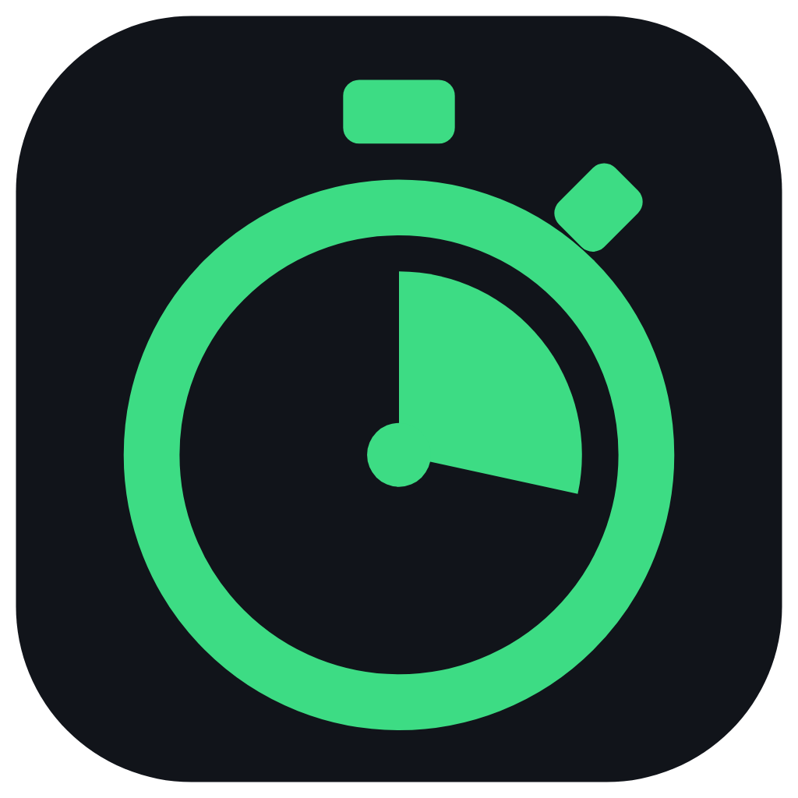

# Cronômetro de Apresentação



Cronômetro que fica no canto da tela, por cima da apresentação em tela cheia, para você não perder o tempo enquanto apresenta. Funciona com PowerPoint, PDF, Keynote, LibreOffice Impress, Google Slides e qualquer outro programa.

Roda no **Windows, macOS e Linux**.

## O que ele faz

* Janelinha flutuante sempre visível, que fica por cima da apresentação em tela cheia (inclusive no macOS, onde a tela cheia vira um espaço separado).
* Contagem regressiva com cores: verde no tempo normal, amarelo no alerta, laranja no último minuto e vermelho piscando quando o tempo acaba, passando a contar o excesso com "+".
* Mostra o horário previsto de término e a hora de Brasília (ou a hora local, se preferir).
* Bipes de aviso opcionais ao entrar no amarelo, no laranja e quando o tempo acaba (vêm desligados, porque com o projetor ligado por HDMI o som pode sair nas caixas da sala).
* Cor do relógio ajustável (verde, azul, ciano, branco, amarelo, laranja, vermelho, roxo, rosa ou qualquer outra) e fundo escuro, preto ou claro, para combinar com a apresentação.
* Atalhos de teclado globais, que funcionam mesmo com a apresentação em primeiro plano.
* Clicar no cronômetro não tira o foco da apresentação: o passador de slides e as setas continuam funcionando.
* Escolha do canto, do tamanho (P, M, G), da opacidade e do monitor (útil com projetor ou segunda tela).
* Pode ser arrastado para qualquer lugar. A posição fica salva.
* Enquanto o tempo corre, o computador não entra em descanso de tela.
* Painel completo, no mesmo estilo dos cronômetros de prova: tempo restante, decorrido, tempo total, término previsto e hora.

## Download

Baixe a versão mais recente na página de [Releases](https://github.com/n-lobato/cronometro-apresentacao/releases/latest).

| Sistema | Arquivo |
|---|---|
| Windows (instalador) | `Cronometro-de-Apresentacao-X.Y.Z-windows-instalador.exe` |
| Windows (portátil, sem instalar) | `Cronometro-de-Apresentacao-X.Y.Z-windows-portatil.exe` |
| macOS com chip Apple (M1, M2, M3, M4) | `Cronometro-de-Apresentacao-X.Y.Z-macos-arm64.dmg` |
| macOS com processador Intel | `Cronometro-de-Apresentacao-X.Y.Z-macos-x64.dmg` |
| Linux (qualquer distribuição) | `Cronometro-de-Apresentacao-X.Y.Z-linux-x86_64.AppImage` |
| Linux (Debian, Ubuntu, Mint) | `Cronometro-de-Apresentacao-X.Y.Z-linux-amd64.deb` |

### Primeira abertura

O programa é gratuito e não tem assinatura digital paga da Microsoft ou da Apple. Por isso o sistema mostra um aviso na primeira vez:

* **Windows:** na tela "O Windows protegeu o computador", clique em **Mais informações** e depois em **Executar assim mesmo**.
* **macOS:** abra o `.dmg`, arraste o app para a pasta Aplicativos e tente abrir. Quando aparecer o aviso, vá em **Ajustes do Sistema > Privacidade e Segurança** e clique em **Abrir Mesmo Assim**. Outra opção é rodar no Terminal:
  `xattr -dr com.apple.quarantine "/Applications/Cronômetro de Apresentação.app"`
* **Linux (AppImage):** dê permissão de execução (`chmod +x Cronometro-*.AppImage`) e abra. Se não abrir no Ubuntu 24.04 ou mais recente, rode com `--no-sandbox` ou prefira o pacote `.deb`.

## Como usar

1. Abra o programa. Aparecem o painel e a janelinha no canto.
2. No painel, escolha a duração (há atalhos de 5 a 120 minutos) e o canto da tela.
3. Inicie a apresentação em tela cheia.
4. Inicie o cronômetro com **dois cliques** na janelinha, pelo botão ▶, pelo painel ou com **Ctrl + Alt + S**.

Na janelinha:

| Ação | Resultado |
|---|---|
| Dois cliques | Inicia ou pausa |
| Botão direito | Abre o menu: iniciar/pausar, reiniciar, ±1 minuto, duração, cor, fundo, tamanho, posição, opacidade, sons e mais |
| Clicar e arrastar | Muda de lugar (a posição fica salva) |

Fechar o painel não encerra o programa: ele continua na bandeja do sistema (ao lado do relógio no Windows e no Linux, na barra de menus no macOS, onde o tempo também aparece). Para sair, use **Sair** no painel ou no menu da bandeja.

### Atalhos de teclado

No macOS, troque Ctrl por ⌘ e Alt por ⌥.

| Atalho | Ação |
|---|---|
| Ctrl + Alt + S | Iniciar / pausar |
| Ctrl + Alt + R | Reiniciar |
| Ctrl + Alt + ↑ | +1 minuto |
| Ctrl + Alt + ↓ | -1 minuto |
| Ctrl + Alt + O | Mostrar / ocultar a janelinha |
| Ctrl + Alt + P | Abrir o painel |

Se outro programa já usar algum desses atalhos, ele aparece riscado no painel. Os atalhos podem ser desligados no painel.

## Outras versões

* **Versão para navegador** (sem instalar): [docs/index.html](docs/index.html). Abra no Chrome ou no Edge e clique em "Abrir no canto da tela". Usa a janela flutuante do próprio navegador.
* **Versão leve para Windows em PowerShell**: [extras/windows-powershell](extras/windows-powershell). Útil em computadores que não permitem instalar programas. Baixe os dois arquivos para a mesma pasta e dê dois cliques em `cronometro.bat`.

## Para desenvolvedores

Requer Node.js 20 ou mais recente. Ao mudar dependências no `package.json`, rode o fluxo **Atualizar lockfile** na aba Actions.

```bash
npm ci             # instala exatamente as versões do package-lock.json
npm start          # abre o app
npm test           # testes unitários
npm run smoke      # teste de fumaça (abre, conta 2 s, salva capturas em smoke-output/)
npm run dist       # gera o instalador do sistema atual em dist/
```

Estrutura:

```
src/main.js            processo principal (janelas, atalhos, bandeja, alertas)
src/preload.js         ponte segura entre as telas e o processo principal
src/settings.js        configurações salvas
src/shared/cron.js     lógica do cronômetro (testada em test/)
src/renderer/          painel e janelinha flutuante
docs/                  versão para navegador
extras/                versão em PowerShell para Windows
```

Os instaladores dos três sistemas são gerados pelo GitHub Actions e anexados automaticamente quando uma release é publicada na página do GitHub.

## Licença

MIT. Autor: n-lobato.
